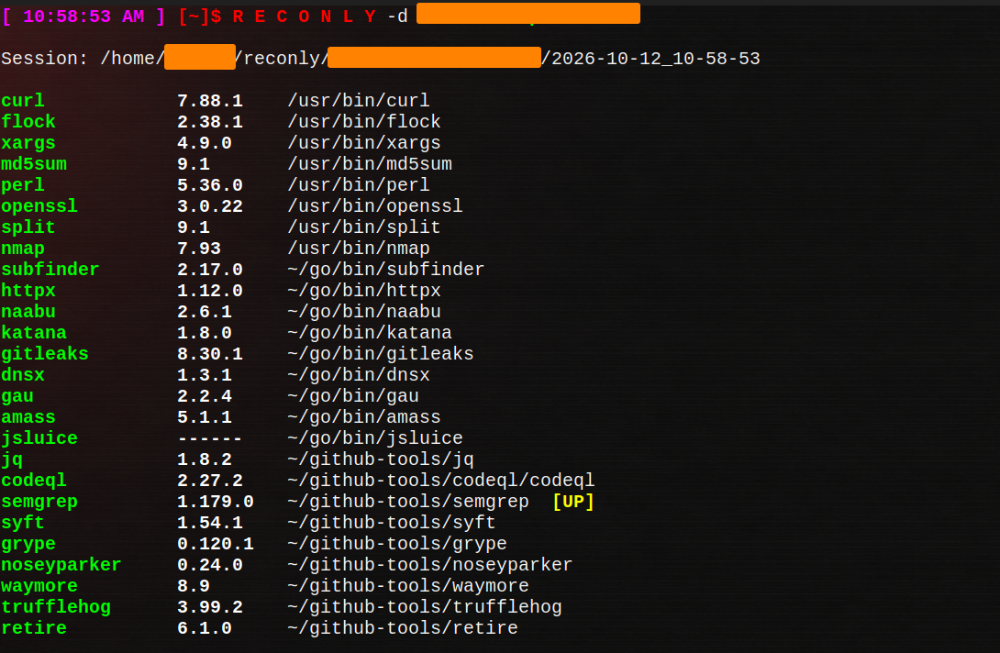

# reconly



Single-file bash automation pipeline for web application recon and attack-surface discovery. It chains subdomain enumeration, port/service discovery, historical archive mining, JS-aware crawling, deep JavaScript analysis (secrets, sourcemaps, deobfuscation), static code analysis, and lightweight vulnerability probes, then packages everything into a self-contained, browsable HTML report.

For authorized security testing only. Run it exclusively against domains or assets you own or are explicitly authorized to test. See Legal and Ethical Use below.

## Features

- Subdomain enumeration: `subfinder` + `amass`, with automatic permutation/mutation scanning (dev-, staging-, api-, etc.) resolved via `dnsx`.
- Host and port discovery: `naabu` (SYN scan when capable, falls back to connect scan) over common ports, followed by `httpx` fingerprinting (tech stack, titles, status codes, TLS, CNAME, favicon hashes) and background `nmap` service/version scans.
- Historical URL mining: `waymore`, Wayback CDX API, and `gau`, merged and deduplicated.
- JS-aware crawling: `katana` (headless-capable) crawls live hosts and revives archived URLs, with soft-404/catch-all detection.
- URL classification: automatic bucketing into JS, JSON, API, artifact (configs/backups/.git/.env), and parameterized/reflection-candidate URL sets.
- Full JS pipeline: recursive JS discovery (webpack chunk guessing, inline script extraction, service-worker parsing) across multiple fetch rounds until fixpoint; sourcemap recovery and original source extraction; deobfuscation (webcrack/synchrony) and formatting (prettier).
- Secrets and static analysis: `jsluice`, `trufflehog`, `gitleaks`, `noseyparker`, plus around 50 built-in regex hunts (cloud keys, DB URIs, JWTs, webhooks, private keys, DOM-XSS sinks, postMessage handlers, hidden paths) with support for custom patterns; `semgrep` and optional `codeql` for taint/SAST findings; `syft` + `grype` and `retire.js`/`npm audit` for vulnerable dependencies.
- App surface mapping: extracted API routes, fetch/axios calls, storage keys, env vars, and a generated site tree.
- Quick vulnerability probes: missing security headers, cookie flag issues, CORS misconfiguration, open redirect confirmation, reflected parameter detection, cloud bucket/storage misconfig (S3, GCS, Azure, Firebase), subdomain takeover indicators, GraphQL introspection, JWT alg:none/expiry checks, SSTI canaries, host-header injection.
- Self-contained HTML report with embedded file tree, syntax highlighting, light/dark theme, and copy-to-clipboard.
- Auto-installs missing tools, adapts request rate under 429/5xx pressure, deduplicates by content hash, resumes cleanly via file-locking/state files.

## Requirements

- Linux (bash 4+), curl, jq, flock, perl, openssl, split, xargs, md5sum.
- Internet access and ideally sudo for naabu SYN scanning capability (cap_net_raw); falls back to connect-scan without it.
- Auto-installed on first run if missing: subfinder, amass, dnsx, httpx, naabu, katana, gau, jsluice, gitleaks, noseyparker, syft, grype, codeql, semgrep, trufflehog, retire, waymore, nmap.
- Optional (improves JS analysis quality if present): npx/Node.js (prettier, webcrack, synchrony), rg (ripgrep).
- codeql JS query packs require a one-time manual download step (the script prompts with instructions if needed).

All tools install into `~/github-tools`, kept out of default system PATH, except OS packages installed via `sudo apt install` (nmap, openssl, unzip).

## Installation

```
git clone https://github.com/Ln0rag/reconly.git
cd reconly
chmod +x reconly.sh
```

No build step required, it is a single bash script.

## Usage

```
./reconly.sh -d target-domain.com
```

| Flag | Description |
|------|-------------|
| -d | Target domain (required). Scheme and www. are stripped automatically. |
| -h | Show usage. |

On completion, the report opens automatically in a browser if available, or the path is printed for manual opening.

### Environment variable overrides

| Variable | Default | Purpose |
|---|---|---|
| RECONLY_MAX_PAGES | 5000 | Max pages crawled/fetched per run |
| RECONLY_JS_THREADS | 15 | Concurrency for JS fetch/analysis |
| RECONLY_FETCH_THREADS | 30 | Concurrency for generic fetches |
| RECONLY_PAGE_THREADS | 8 | Concurrency for page retries |
| NAABU_RATE | 100 | Packets/sec for port scanning |
| NAABU_RETRIES | 1 | naabu retry count |
| KATANA_HEADLESS | unset | Set to any value to enable headless crawling |
| RECONLY_AUTO_INSTALL | 1 | Set to 0 to disable auto-installing missing tools |
| RECONLY_CHECK_UPDATES | 1 | Set to 0 to skip the background tool-update check |
| NMAP_TAB | 0 | Set to 1 to open a live-tailing terminal for the background nmap sweep |
| NOOPEN | 0 | Set to 1 to skip auto-opening the report in a browser |

### Custom detection patterns

Place a `hunt-custom.txt` file at `~/github-tools/hunt-custom.txt` to add custom regex-based secret/surface detections. Format:

```
Pattern Name|regex|SEVERITY
[SURFACE] Pattern Name|regex|INFO
```

## Output structure

Each run creates a timestamped session under:

```
~/reconly/<domain>/<YYYY-MM-DD_HH-MM-SS>/
  subdomains/      enumeration and permutation results
  hosts/           live hosts, open ports, httpx fingerprints
  urls/            classified URL sets (js, json, api, artifacts, params)
  js/              raw/formatted/deobfuscated JS, sourcemaps, extracted sources
  findings/
    secrets/       secret-hunting output plus UNIQUE-SECRETS.tsv (deduped)
    surface/       routes, API calls, storage keys, site tree
    analysis/      semgrep, codeql, vulnerable-libs, graphql, postMessage verdicts
    probes/        header/CORS/redirect/cloud-misconfig/takeover probe results
  state/           resumable progress and dedup state
  reconly.log      full run log
  report.html      self-contained interactive report
```

## Pipeline order

1. Subdomains: subfinder + amass + permutation/mutation + resolving.
2. Hosts and port scanning: naabu + httpx + TLS SAN hostname discovery + background nmap.
3. Archive: waymore, Wayback CDX, gau.
4. Crawl: katana over live hosts, with soft-404 detection and archive revival.
5. Classify: bucket all discovered URLs by type.
6. JS pipeline: recursive fetch, sourcemap recovery, deobfuscation, formatting, run to fixpoint.
7. Local analysis: secret scanners, custom regex hunts, semgrep, codeql, dependency vulnerability checks.
8. App surface: route/API/storage-key/env-var extraction, site tree.
9. Context: source-line context extraction for high/critical findings.
10. Quick probes: header, cookie, CORS, redirect, reflection, cloud-misconfig, takeover, GraphQL, JWT, SSTI checks.
11. Report generation: everything packaged into report.html.

## Legal and Ethical Use

This tool performs active reconnaissance (port scanning, crawling, parameter probing, cloud storage access attempts) against its target. Only run it against assets you own or have explicit written authorization to test, such as a scoped bug bounty program or signed pentest agreement. Unauthorized scanning of systems without permission may be illegal in your jurisdiction. The authors of this tool assume no liability for misuse.

## Disclaimer

Provided as-is, with no warranty. It downloads and executes a number of third-party open-source tools from their official repositories on first run. Review the install commands in the script for full visibility before running it on a sensitive host.
